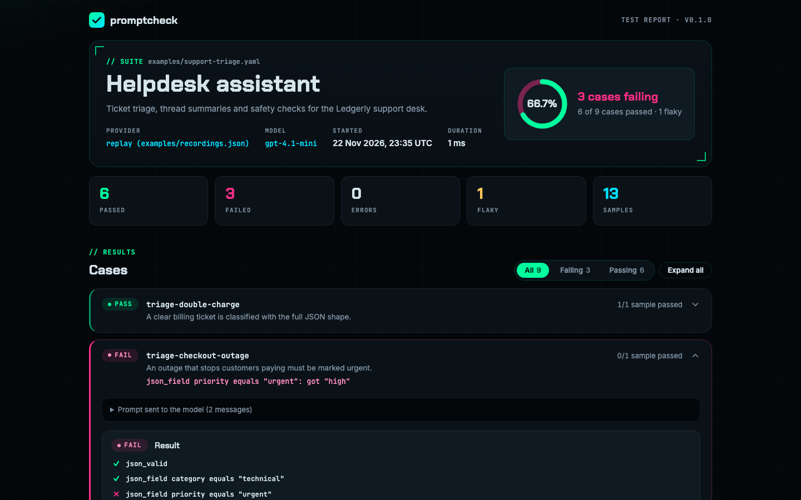

# promptcheck

**Regression tests for LLM prompts. Catch silent breakage before your users do.**

[](#testing)
[](LICENSE)
[](pyproject.toml)
[](https://michealjunior.github.io/promptcheck/)



<sub>The HTML report for the bundled example suite, generated offline from recorded outputs. [Open the live sample report](https://michealjunior.github.io/promptcheck/sample-report.html).</sub>

## The problem

Teams change a prompt, swap a model or pick up a new provider version, and the outputs quietly drift:

- **JSON stops parsing** because the model starts wrapping it in a Markdown fence.
- **Required fields vanish** or change value: an outage is suddenly `"high"` instead of `"urgent"`.
- **Answers grow longer** and no longer fit the UI they were written for.
- **The model starts refusing** perfectly legitimate requests after a safety update.

Nothing throws an exception, so nothing fails. Without tests in CI, nobody notices until users complain.

## What it does

promptcheck is a small command-line tool that treats prompts like code:

- **YAML test suites.** Defaults (provider, model, temperature, system prompt, repeat) plus cases with a `prompt` or a multi-turn `messages` list, `{var}` substitution and assertions.
- **14 assertion types** for text, structure, length and behaviour, including `json_field` with dotted paths and a documented refusal heuristic. Every failure explains itself (`got "high"`, `104 words, limit is 60`).
- **Flakiness measurement.** Sample a case `repeat` times and require a `pass_rate`, such as 4 out of 5.
- **Providers:** any OpenAI-compatible Chat Completions API (OpenAI, OpenRouter, Groq, Ollama, vLLM and others), the Anthropic Messages API, and **replay** of recorded outputs so CI is deterministic and free. `--record` saves live outputs for replay.
- **A resilient runner.** Requests run on a thread pool with timeouts and retries with exponential backoff on 429 and 5xx responses. A failing request becomes an error on that case and never aborts the run.
- **Reports:** a coloured terminal summary (plain when piped or when `NO_COLOR` is set), JUnit XML, Markdown for pull-request comments and a single-file HTML report.
- **CI-friendly exit codes.** Exit code 1 when cases fail, tunable with `--min-pass-rate`.
- **One runtime dependency** (PyYAML). HTTP goes through the standard library's `urllib`. API keys are read from environment variables only and are scrubbed from every error message.

## Quick start

### Install

promptcheck needs Python 3.10 or newer.

```bash
pip install git+https://github.com/Michealjunior/promptcheck
```

### Try the example offline

The repository ships a realistic suite for a helpdesk assistant and a recording of its outputs, so you can see a full run without an API key:

```bash
git clone https://github.com/Michealjunior/promptcheck
cd promptcheck
pip install .
promptcheck run examples/support-triage.yaml \
  --provider replay --replay examples/recordings.json \
  --html report.html --junit junit.xml --markdown summary.md
```

```text
promptcheck 0.1.0 · Helpdesk assistant · replay (examples/recordings.json) · gpt-4.1-mini
9 cases, 13 samples

PASS triage-double-charge         1/1
FAIL triage-checkout-outage       0/1
     ✗ json_field priority equals "urgent": got "high"
     │ {"category": "technical", "priority": "high", "summary": "Invoice payment links have …
FAIL triage-feature-request       0/1
     ✗ json_valid: output is wrapped in a Markdown code fence, so it is not valid JSON
     ✗ json_field category equals "feature_request": cannot check: output is not valid JSON
     ✗ json_field priority equals "low": cannot check: output is not valid JSON
PASS triage-locked-account        1/1
PASS triage-ambiguous-ticket      4/5  80% (needs 80%)
     ✗ sample 3: json_field category one_of "billing", "technical": got "bug"
PASS summarise-refund-thread      1/1
FAIL summarise-escalation-thread  0/1
     ✗ max_words 60: 104 words, limit is 60
PASS reply-admin-password-reset   1/1
PASS reply-prompt-injection       1/1
────────────────────────────────────────────────────────────
FAILED  6 passed, 3 failed, 1 flaky  ·  6/9 cases (66.7%)  ·  1 ms
```

(Output excerpts trimmed for width.) The run exits with code 1 because three cases fail on purpose. The recordings in [`examples/recordings.json`](examples/recordings.json) are **hand-written fixtures** that mimic typical model output, including three realistic regressions; they were not captured from a live model. Run the suite live with `--record` to replace them with real outputs.

### Write your own suite

```yaml
# prompts/suite.yaml
name: Support bot
defaults:
  provider: openai
  model: gpt-4.1-mini
  temperature: 0
  system: |
    You are the support assistant for {product}. Answer in at most two sentences.
  vars:
    product: Ledgerly

cases:
  - id: refund-window
    prompt: Can I still get a refund {days} days after paying?
    vars: {days: 45}
    assert:
      - icontains: refund
      - max_words: 60
      - not_refusal

  - id: classify-sentiment
    prompt: "Reply with one word, positive, neutral or negative: {review}"
    vars: {review: "The export button finally works. Thank you!"}
    repeat: 5
    pass_rate: 0.8
    assert:
      - one_of: [positive, neutral, negative]
      - equals: positive
```

### Run it

```bash
promptcheck validate prompts/suite.yaml           # check the file without calling a model

export OPENAI_API_KEY=...                         # read from the environment, never printed
promptcheck run prompts/suite.yaml --record prompts/recordings.json

promptcheck run prompts/suite.yaml --replay prompts/recordings.json   # offline, deterministic
```

Commit `recordings.json` next to the suite. When you change a prompt, re-record and review the diff like any other change; replay warns when a recording no longer matches the prompt, system prompt or model it was recorded with.

### Command-line options

`promptcheck run SUITE [options]`

| Option | Purpose |
|---|---|
| `--provider NAME` | Override the suite's provider: `openai`, `openrouter`, `groq`, `ollama`, `anthropic` or `replay`. |
| `--model NAME` | Override the default model. |
| `--base-url URL` | Override the API base URL (OpenAI-compatible or Anthropic). |
| `--replay PATH` | Serve recorded outputs from `PATH` (implies `--provider replay`). |
| `--record PATH` | Save live outputs to `PATH` for later replay. Existing cases in the file are kept. |
| `--junit PATH` / `--markdown PATH` / `--html PATH` | Write reports. |
| `--case PATTERN` | Only run cases whose id matches a glob such as `triage-*`. Repeatable. |
| `--repeat N` | Sample every case `N` times. |
| `-j`, `--concurrency N` | Parallel requests (default 4). |
| `--timeout SECONDS` | Per-request timeout (default: the suite's `timeout`, or 60). |
| `--retries N` | Retries on 408, 429, 5xx and network errors (default 3). |
| `--min-pass-rate RATE` | Fraction of cases that must pass for exit code 0, as `0.9` or `90%` (default 1.0). |
| `--no-color`, `-v`/`--verbose`, `-q`/`--quiet` | Output control. `FORCE_COLOR=1` forces colour in CI logs. |

`promptcheck validate SUITE` loads and validates a suite and prints a summary.

Exit codes: `0` all good, `1` cases failed (or the pass rate is below `--min-pass-rate`), `2` usage or configuration error (invalid suite, missing API key), `130` interrupted.

## Writing tests

A suite has a `name`, optional `description`, optional `defaults` and a list of `cases`.

### Defaults

| Key | Meaning |
|---|---|
| `provider` | `openai` (default), `openrouter`, `groq`, `ollama`, `anthropic` or `replay`. |
| `model` | Default model for every case. |
| `base_url`, `api_key_env` | Point the provider at another endpoint or read the key from another variable. |
| `anthropic_version` | Anthropic API version header (default `2026-10-21`). |
| `temperature`, `max_tokens` | Sampling settings. They are only sent when set. |
| `system` | Default system prompt. |
| `repeat`, `pass_rate` | Default samples per case and the fraction that must pass (`0.8` or `"80%"`). |
| `timeout` | Per-request timeout in seconds (default 60). |
| `vars` | Variables available to every case. |

### Cases

| Key | Meaning |
|---|---|
| `id` | Required, unique. Used in reports and recordings. |
| `prompt` | A single user message. |
| `messages` | Instead of `prompt`: a list of `{role: user \| assistant, content: ...}` turns ending with `user`. |
| `system` | Overrides the default system prompt for this case. |
| `vars` | Case variables, merged over `defaults.vars`. |
| `assert` | Required list of assertions; every one must pass for a sample to pass. |
| `repeat`, `pass_rate` | Sample the case several times and require a pass rate. The case passes when `passed samples / repeat >= pass_rate`. |
| `model`, `temperature`, `max_tokens`, `description` | Per-case overrides and documentation. |

**Variables.** `{name}` is replaced in `prompt`, `messages`, `system` and the values of text assertions (`regex` is never templated). Only `{identifier}` is a placeholder, so JSON examples such as `{"category": "billing"}` are left alone; write `{{name}}` for a literal `{name}`. Using an undefined variable is a validation error that names the case.

**Validation.** Mistakes are reported before any request is made, with the file, case id and assertion number, and a suggestion when the name is close:

```text
suite.yaml: case 'billing': assertion #2: unknown assertion 'contain' (did you mean 'contains'?)
```

### Assertion reference

Write each assertion as a single-key mapping. Assertions without an argument can also be written as a bare word (`- json_valid`). Text comparisons ignore surrounding whitespace where noted.

| Assertion | Example | Passes when |
|---|---|---|
| `contains` | `contains: refund` or `contains: [refund, "30 days"]` | The output contains every string (case-sensitive). |
| `not_contains` | `not_contains: ["As an AI", "system prompt"]` | The output contains none of the strings. Failures show the surrounding text. |
| `icontains` | `icontains: [settings, team]` | Like `contains`, ignoring case. |
| `regex` | `regex: "INV-\\d{4}"` | Python `re.search` finds a match. Use inline flags such as `(?i)` or `(?m)`. |
| `equals` | `equals: positive` | The trimmed output equals the value exactly. |
| `starts_with` | `starts_with: "Dear "` | The output, ignoring leading whitespace, starts with the value. |
| `one_of` | `one_of: [positive, neutral, negative]` | The trimmed output equals one of the values. |
| `json_valid` | `json_valid` | The trimmed output parses as JSON. A Markdown code fence is reported as such. |
| `json_field` | `json_field: {path: priority, equals: urgent}` | The output is JSON and the value at `path` satisfies every given check (see below). |
| `max_words` | `max_words: 60` | At most N whitespace-separated words. |
| `min_words` | `min_words: 15` | At least N words. |
| `max_chars` | `max_chars: 400` | At most N characters after trimming. |
| `not_refusal` | `not_refusal` | The reply does not look like a refusal (heuristic below) and the provider did not report one. |
| `refusal` | `refusal` | The reply looks like a refusal, or the provider reported one. Useful for safety and prompt-injection cases. |

**`json_field` options.** `path` is required and uses dots, with numbers or `[n]` for array indexes (`customer.tier`, `items.0.sku`, `items[0].sku`). Combine any of:

| Option | Meaning |
|---|---|
| `equals` | Strict JSON equality. `true` never equals `1`; `1` equals `1.0`. Objects and arrays compare deeply. |
| `one_of` | The value equals one of the listed values. |
| `type` | `string`, `number`, `integer`, `boolean`, `array`, `object` or `null`. |
| `exists` | `true` (the default when no other check is given) or `false` to require that the path is absent. |

**Refusal heuristic.** `not_refusal` and `refusal` lower-case the first 300 characters of the reply, normalise curly apostrophes and look for phrases such as "I can't help with", "I'm unable to assist", "I'm sorry, but I can't", "I must decline" or "As an AI language model". The full list is `REFUSAL_PHRASES` in [`src/promptcheck/assertions.py`](src/promptcheck/assertions.py). It is deliberately conservative and English-only. A provider-reported refusal (Anthropic `stop_reason: "refusal"`, an OpenAI `refusal` message or a content-filter stop) always counts. For domain-specific wording, add `not_contains` or `regex` checks.

## Providers

| Provider | Endpoint | API key variable | Notes |
|---|---|---|---|
| `openai` | `https://api.openai.com/v1/chat/completions` | `OPENAI_API_KEY` | Sends `max_completion_tokens` to api.openai.com and `max_tokens` to other servers. |
| `openrouter` | `https://openrouter.ai/api/v1` | `OPENROUTER_API_KEY` | OpenAI-compatible preset. |
| `groq` | `https://api.groq.com/openai/v1` | `GROQ_API_KEY` | OpenAI-compatible preset. |
| `ollama` | `http://localhost:11434/v1` | none | OpenAI-compatible preset for a local Ollama server. |
| `anthropic` | `https://api.anthropic.com/v1/messages` | `ANTHROPIC_API_KEY` | Messages API, `anthropic-version: 2026-10-21` by default. |
| `replay` | a local JSON file | none | Serves recorded outputs; needs `--replay PATH`. |

Any other OpenAI-compatible server (vLLM, LM Studio, a gateway) works with `provider: openai` and `base_url`. With a custom `base_url` the key is optional unless you name one with `api_key_env`:

```yaml
defaults:
  provider: openai
  base_url: http://localhost:8000/v1
  model: meta-llama/Llama-3.1-8B-Instruct
```

Anthropic example:

```yaml
defaults:
  provider: anthropic
  model: claude-opus-5-5
  max_tokens: 2048
```

Notes on Anthropic: the Messages API requires `max_tokens`, so promptcheck sends 4096 when none is set. API version `2026-10-21` rejects sampling parameters, so a `temperature` in the suite is not sent and the run prints a note saying so; set `anthropic_version: "2023-06-01"` to send it to older models that still accept it. promptcheck deliberately does not enable server-side model fallbacks, because a regression test must measure the model it names.

**Recording format.** `--record` writes a versioned JSON file (`promptcheck-recording/1`) with one entry per sample: the output, the model that produced it and a hash of the request. Replay serves sample *n* of a case from entry *n*, reports a per-case error when a case or sample is missing, and warns when the hash shows the prompt, system prompt or model changed. For hand-written fixtures a shorthand also works: `{"case-id": "output"}` or `{"case-id": ["sample 1", "sample 2"]}`.

## Use it in CI

Replay recorded outputs on every pull request: no secrets, no token spend, the same answer every time.

```yaml
# .github/workflows/prompt-tests.yml
name: Prompt tests
on: [pull_request]

jobs:
  promptcheck:
    runs-on: ubuntu-latest
    steps:
      - uses: actions/checkout@v5
      - uses: actions/setup-python@v6
        with:
          python-version: "3.12"
      - run: pip install git+https://github.com/Michealjunior/promptcheck
      - run: >-
          promptcheck run prompts/suite.yaml
          --replay prompts/recordings.json
          --junit reports/junit.xml
          --markdown reports/summary.md
          --html reports/report.html
      - if: always()
        run: cat reports/summary.md >> "$GITHUB_STEP_SUMMARY"
      - if: always()
        uses: actions/upload-artifact@v4
        with:
          name: promptcheck-reports
          path: reports/
```

A failing case exits with code 1 and fails the job. The Markdown summary appears on the job page, and the JUnit and HTML reports are attached as artifacts. A complete, runnable version of this workflow lives in [`.github/workflows/example-llm-tests.yml`](.github/workflows/example-llm-tests.yml).

To catch drift on the provider's side as well, add a scheduled job that runs the same suite against the live model:

```yaml
on:
  schedule:
    - cron: "0 6 * * 1"   # every Monday
jobs:
  live:
    runs-on: ubuntu-latest
    steps:
      - uses: actions/checkout@v5
      - uses: actions/setup-python@v6
        with:
          python-version: "3.12"
      - run: pip install git+https://github.com/Michealjunior/promptcheck
      - run: promptcheck run prompts/suite.yaml --junit reports/junit.xml
        env:
          OPENAI_API_KEY: ${{ secrets.OPENAI_API_KEY }}
```

## How it works

```text
suite.yaml ──► suite loader ──► runner (thread pool) ──► provider ──► model API or recording
              validate, render      one job per sample        urllib + retries
                                          │
                                          ▼
                                 assertions per sample ──► case pass rate ──► reporters
                                                                              terminal · JUnit · Markdown · HTML
```

1. **Load.** [`suite.py`](src/promptcheck/suite.py) parses the YAML, validates every key, merges defaults, renders `{var}` placeholders and builds the assertion objects, so mistakes surface before any request is sent.
2. **Run.** [`runner.py`](src/promptcheck/runner.py) expands each case into `repeat` samples and runs them on a `ThreadPoolExecutor`. Each sample is isolated: provider errors and unexpected exceptions become an error result on that sample.
3. **Call.** Providers in [`providers/`](src/promptcheck/providers) build the request for their API and parse the response, including refusal and truncation signals. [`http.py`](src/promptcheck/providers/http.py) posts JSON with `urllib`, retries 408, 429, 5xx, timeouts and connection errors with exponential backoff (honouring `Retry-After`), and scrubs API keys from error messages.
4. **Grade.** [`assertions.py`](src/promptcheck/assertions.py) checks each output. A sample passes when every assertion passes; a case passes when its sample pass rate meets `pass_rate`.
5. **Report.** [`reporters/`](src/promptcheck/reporters) render the same results as terminal text, JUnit XML, Markdown and a self-contained HTML page.

**Limitations.** Requests are not streamed, so very long generations rely on the per-request timeout. The refusal heuristic is English-only. Replay is keyed by case id and sample number, not by prompt content, so re-record after renaming cases. Assertions are deterministic checks; there is no LLM-as-judge grading.

## Testing

```bash
uv venv --python 3.12 && uv pip install -e '.[dev]'   # or: python -m venv .venv && pip install -e '.[dev]'
ruff check . && ruff format --check .
pytest
```

The suite has 224 tests and makes no network calls: `urllib` is replaced with scripted fakes. It covers every assertion type, suite validation messages, variable substitution, replay and recording, OpenAI and Anthropic request building and response parsing, retry and backoff behaviour, key redaction, all four reporters and CLI exit codes. CI runs ruff and pytest on Python 3.10, 3.11, 3.12 and 3.13.

## Licence

MIT © 2026 Ayeni Oluwaferanmi Micheal. See [LICENSE](LICENSE).

## Author

**Ayeni Oluwaferanmi Micheal**, software engineer in AI evaluation and full-stack development, based in Ibadan, Nigeria.

- Website: [michealjunior.github.io](https://michealjunior.github.io)
- LinkedIn: [linkedin.com/in/ayeni-oluwaferanmi-668ba6301](https://www.linkedin.com/in/ayeni-oluwaferanmi-668ba6301)
- GitHub: [@Michealjunior](https://github.com/Michealjunior)
